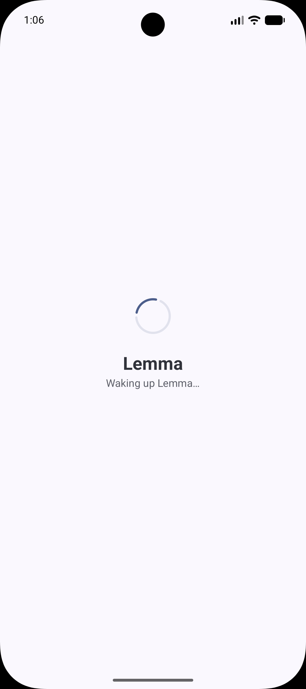
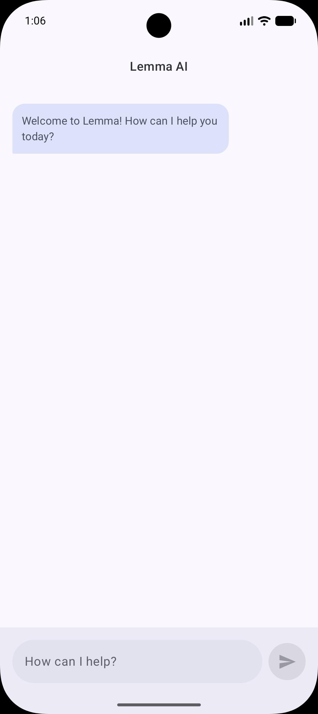
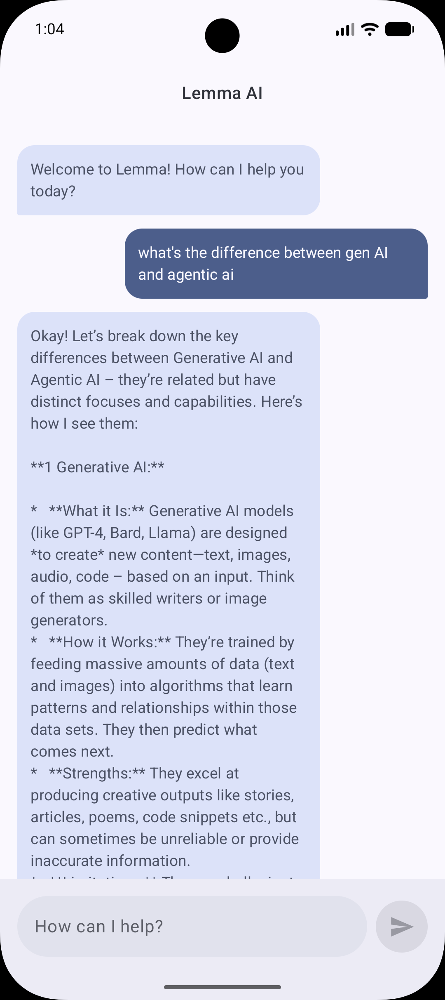
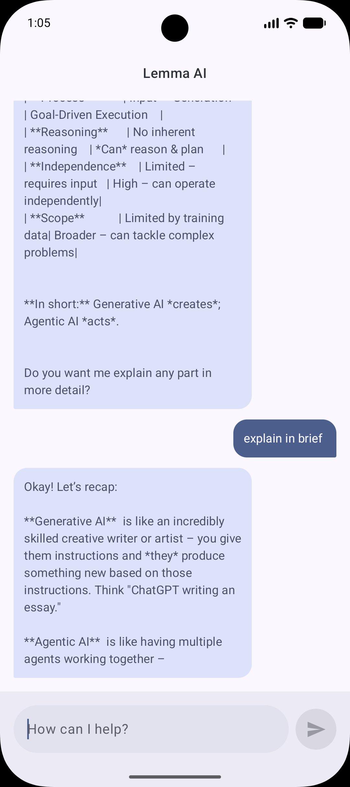

# Lemma AI 🧠

Lemma is a lightweight, privacy-focused Android chat application that leverages **Google LiteRT (formerly MediaPipe)** to run Large Language Models (LLM) entirely on-device. No data ever leaves your phone.

## ✨ Features

- **On-Device Inference:** Powered by Gemma, ensuring 100% privacy and offline availability.
- **Modern UI:** Built entirely with **Jetpack Compose** and **Material 3**.
- **Responsive Design:** Dynamic message bubbles with smooth animations and IME (keyboard) awareness.
- **Real-time Feedback:** Visual indicators for model initialization and response generation.

## 📸 Screenshots

| Initialization | Chat Interface |
| :---: | :---: |

|  |
|  |
|  |
|  |
| *Lemma initializing the LLM* | *On-device conversation* |

## 🛠️ Technical Stack

- **Language:** [Kotlin](https://kotlinlang.org/)
- **UI Framework:** [Jetpack Compose](https://developer.android.com/jetpack/compose)
- **Design System:** Material Design 3
- **AI Engine:** [Google LiteRT (Gemma)](https://ai.google.dev/edge/litert)
- **Architecture:** MVVM with StateFlow for reactive UI updates

## 🚀 Getting Started

### Prerequisites
- Android Studio Ladybug or newer.
- A physical Android device with at least 4GB of RAM (recommended for LLM inference).
- A Gemma model file (`.bin`) placed in the `assets` folder.

### Installation
1. Clone the repository:
   
